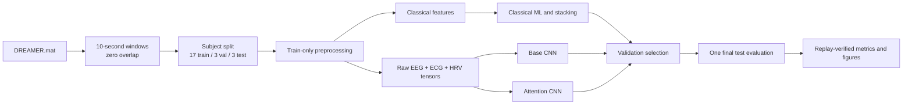

# Subject-Independent Multimodal Arousal Classification on DREAMER

A leakage-audited research pipeline for three-class **self-reported arousal**
classification from DREAMER EEG, raw ECG, and ECG-derived HRV. The repository
compares four classical classifiers, a stacking ensemble, Base CNN, and a
paper-inspired attention network under one fixed subject-independent protocol.

> [!IMPORTANT]
> DREAMER provides arousal ratings, not clinical stress labels. The results in
> this repository support low/medium/high arousal classification only. The
> attention model adapts concepts from a 2026 stress-detection paper; it is not
> a faithful reproduction of that paper.

## Project at a glance

| Item | Value |
|---|---|
| Dataset | DREAMER: 23 participants × 18 film trials |
| Modalities | 14-channel EEG, raw ECG, 25 ECG-derived HRV features |
| Target | Low (ratings 1–2), medium (3), high (4–5) arousal |
| Segmentation | Non-overlapping 10-second windows |
| Split | 17 train / 3 validation / 3 test participants |
| Samples | 6,188 train / 1,092 validation / 1,092 test windows |
| Primary metric | Test macro-F1 |
| Deep-learning runtime | Kaggle Tesla T4 |
| Reproducibility seed | 20261011 |

## Results

All seven methods use the same target definition, subject partitions, test
sample order, and evaluation code. Model and checkpoint selection use validation
macro-F1; the test partition remains isolated until final evaluation.

| Method | Family | Accuracy | Balanced accuracy | Macro-F1 | Macro-AUROC |
|---|---|---:|---:|---:|---:|
| Adapted stacking | Classical ensemble | **0.4698** | **0.3930** | **0.3755** | 0.5097 |
| Paper-inspired attention | Deep learning | 0.4029 | 0.3732 | 0.3554 | **0.5117** |
| kNN | Classical ML | 0.3901 | 0.3160 | 0.3020 | 0.4578 |
| Random forest | Classical ML | 0.4560 | 0.3449 | 0.2933 | 0.4367 |
| Logistic regression | Classical ML | 0.3361 | 0.2884 | 0.2791 | 0.4236 |
| RBF SVM | Classical ML | 0.4524 | 0.3275 | 0.2533 | 0.3945 |
| Base CNN | Deep learning | 0.3297 | 0.3584 | 0.2394 | 0.4843 |


The stacking ensemble leads macro-F1 and balanced accuracy. The attention model
improves macro-F1 by 0.1160 over Base CNN and has the highest macro-AUROC, but
its 0.0019 AUROC advantage over stacking is too small to establish superiority
with only three held-out participants.

| Per-class behavior | Held-out-participant variability |
|---|---|
|  |  |

Detailed window-, trial-, class-, and participant-level results are available
in the [experimental results report](docs/experimental-results.md).

## Methods

| Method | Input representation | Main configuration |
|---|---|---|
| Logistic regression | 276 handcrafted EEG/ECG/HRV features | C=10, balanced classes |
| RBF SVM | 276 handcrafted features | C=1, gamma=`scale`, balanced classes |
| Random forest | 276 handcrafted features | 500 trees, minimum leaf size 5 |
| kNN | Scaled handcrafted features | k=5, distance weighting |
| Adapted stacking | 64 ANOVA-selected features | 7 grouped-fold base learners + logistic meta-learner |
| Base CNN | Raw EEG, raw ECG, HRV | Separate temporal branches and late concatenation |
| Paper-inspired attention | Raw EEG, raw ECG, HRV | Multi-scale EEG, ECG/HRV fusion, learned modality attention |

### Deep architectures

| Model | Trainable parameters | Selected epoch | Epochs run | Test macro-F1 |
|---|---:|---:|---:|---:|
| Base CNN | 215,843 | 25 | 37 | 0.2394 |
| Paper-inspired attention | 1,846,085 | 12 | 24 | 0.3554 |

Both networks use AdamW, learning rate 3×10⁻⁴, weight decay 10⁻⁴, cosine
scheduling, batch size 32, weighted cross-entropy, label smoothing 0.1, mixed
precision, train-only augmentation, and early stopping with patience 12.

| Base CNN training | Attention training |
|---|---|
|  |  |

Both models overfit their training participants. See
[methodology and reproducibility](docs/methodology-and-reproducibility.md) for
the leakage controls, architecture details, and 2026-paper comparison.

## Evaluation workflow



Leakage controls include subject-disjoint partitions, zero temporal overlap,
train-only scaler fitting, fold-local feature selection, validation-only model
selection, and exact replay of saved predictions.

## Repository layout

```text
configs/                         fixed experimental protocol
data/                            dataset instructions and processed metadata
docs/                            public scientific reports
kaggle/                          reproducible Kaggle CPU/GPU notebooks
modal/                           archived pre-migration execution prototype
notebooks/
  workflows/                     corrected analysis notebooks
  exploratory/                   optional dataset inspection
  legacy/                        archived pre-correction notebooks
results/
  corrected/                     validated metrics, predictions, and figures
  legacy/                        isolated leakage-affected historical outputs
scripts/
  data/                          dataset audit and cache construction
  experiments/                   classical, stacking, ablation, and deep runs
  results/                       ingestion, comparison, and replay verification
  reporting/                     optional local document and package utilities
src/stress_classification/       reusable preprocessing, modeling, and evaluation
tests/                           automated protocol and implementation tests
```

Important entry points are summarized in [scripts/README.md](scripts/README.md),
and notebook roles are documented in [notebooks/README.md](notebooks/README.md).

## Dataset setup

Download DREAMER from the
[Kaggle dataset page](https://www.kaggle.com/datasets/phhasian0710/dreamer) and
place `DREAMER.mat` at `data/DREAMER.mat`.

| Integrity property | Expected value |
|---|---|
| File size | 452,847,973 bytes |
| SHA-256 | `35eed939e6f206a0938b13ba063178e2795ef1739b9cac8e5704a968393f3463` |
| Generated windows | 8,372 |
| Window duration / stride | 10 s / 10 s |

The authoritative protocol is
[`configs/dreamer_arousal_3class.yaml`](configs/dreamer_arousal_3class.yaml).
The raw dataset and generated tensor cache are intentionally excluded from Git.

## Installation

Python 3.10 or newer is supported.

```powershell
python -m venv .venv
.\.venv\Scripts\Activate.ps1
python -m pip install --upgrade pip
python -m pip install -e ".[test,notebooks,kaggle]"
```

Install the PyTorch build appropriate for the local CUDA environment when GPU
execution is required.

## Reproduce and verify

### Validate the repository and saved experiments

```powershell
$env:PYTEST_DISABLE_PLUGIN_AUTOLOAD = "1"
python -m pytest
python scripts/results/verify_experiment_artifacts.py
```

The verifier recomputes metrics from saved probabilities and checks the fixed
sample order, labels, confusion matrices, comparison table, trial aggregation,
per-class table, and participant-level table for all seven methods.

### Rebuild preprocessing and classical experiments

```powershell
python scripts/data/audit_dataset.py --output-dir data/processed
python scripts/data/build_deep_cache.py
python scripts/experiments/train_classical_models.py
python scripts/experiments/train_adapted_stacking.py
python scripts/experiments/evaluate_modality_ablation.py
python scripts/results/build_model_comparison.py
```

### Reproduce deep experiments on Kaggle

```powershell
python kaggle/build_kernels.py
```

The generated notebooks preserve the same configuration, sample IDs, seed,
checkpoint logic, and artifact layout used by the completed Tesla T4 runs.
Submission and artifact-ingestion instructions are in
[`kaggle/README.md`](kaggle/README.md).

## Result artifacts

| Artifact | Location |
|---|---|
| Unified metrics | `results/corrected/dreamer_arousal_3class/comparison_all.csv` |
| Per-class metrics | `results/corrected/dreamer_arousal_3class/per_class_metrics.csv` |
| Participant metrics | `results/corrected/dreamer_arousal_3class/subject_metrics.csv` |
| Base CNN run | `results/corrected/dreamer_arousal_3class/base_cnn/` |
| Attention run | `results/corrected/dreamer_arousal_3class/paper_inspired_attention/` |
| Stacking run | `results/corrected/dreamer_arousal_3class/paper_2023_adapted_stacking/` |
| Replay verification | `results/corrected/dreamer_arousal_3class/verification_summary.json` |

Large fitted models (`*.pt`, `*.joblib`) remain local and are excluded from Git.
The tracked predictions, metrics, configurations, logs, and figures are
sufficient to audit every reported measurement.

## Scientific limitations

| Limitation | Consequence |
|---|---|
| Arousal is not equivalent to stress | Results cannot support clinical stress-detection claims |
| Only three held-out participants | Small differences should not be treated as population-level superiority |
| High-arousal class is largest | Accuracy can obscure weak minority-class recall |
| Strong train/validation gaps | Both CNNs show cross-participant overfitting |
| Ten-second HRV windows | Low-frequency HRV interpretation is limited |
| Different task from the 2026 paper | Its reported 95.7% accuracy is not directly comparable |

Historical random-window results remain under `results/legacy/` for provenance
only and must not be compared with the corrected subject-independent results.

## Documentation

- [Experimental results](docs/experimental-results.md)
- [Methodology, leakage controls, and reference-paper comparison](docs/methodology-and-reproducibility.md)
