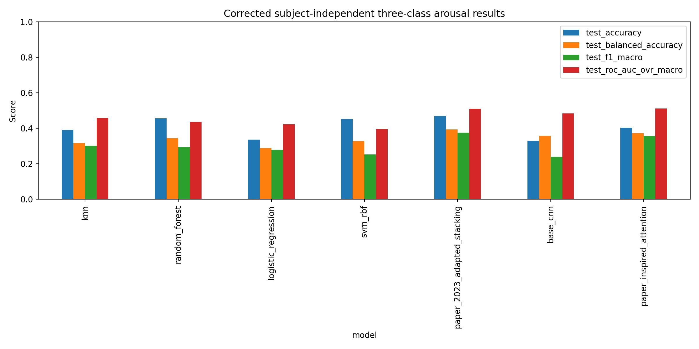
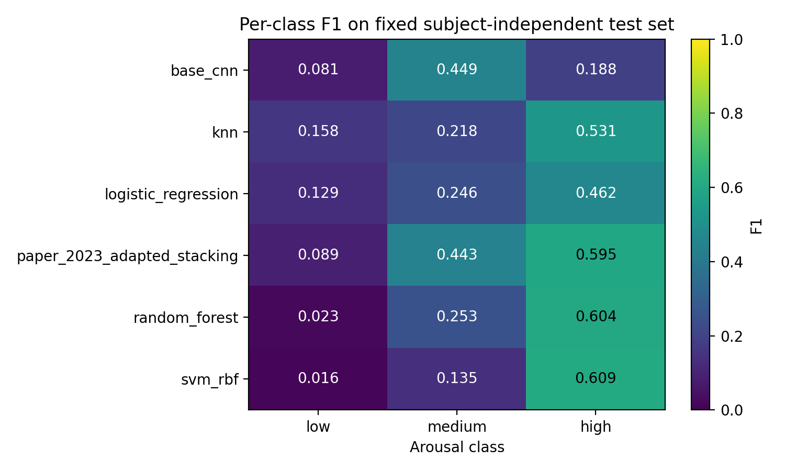
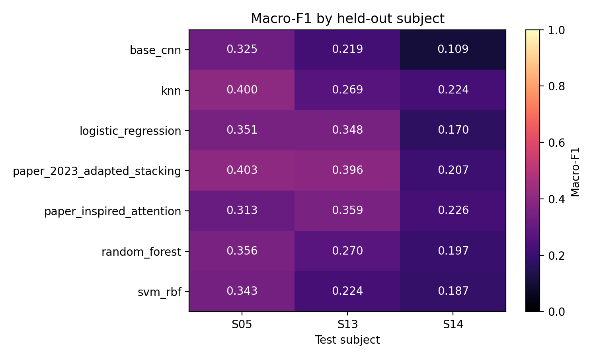
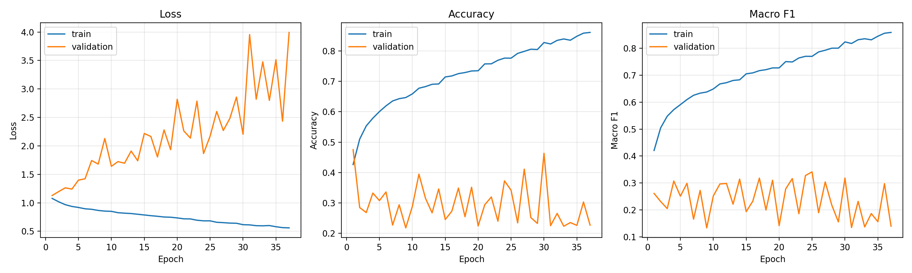
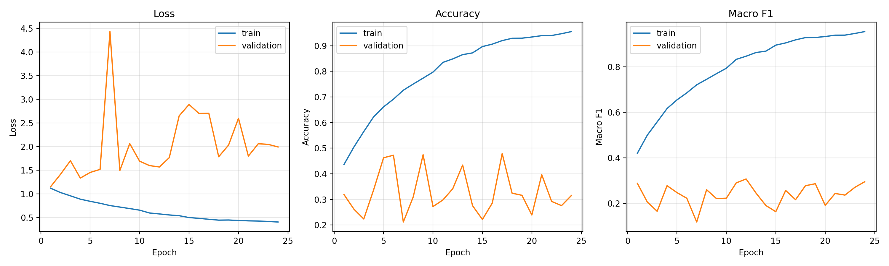
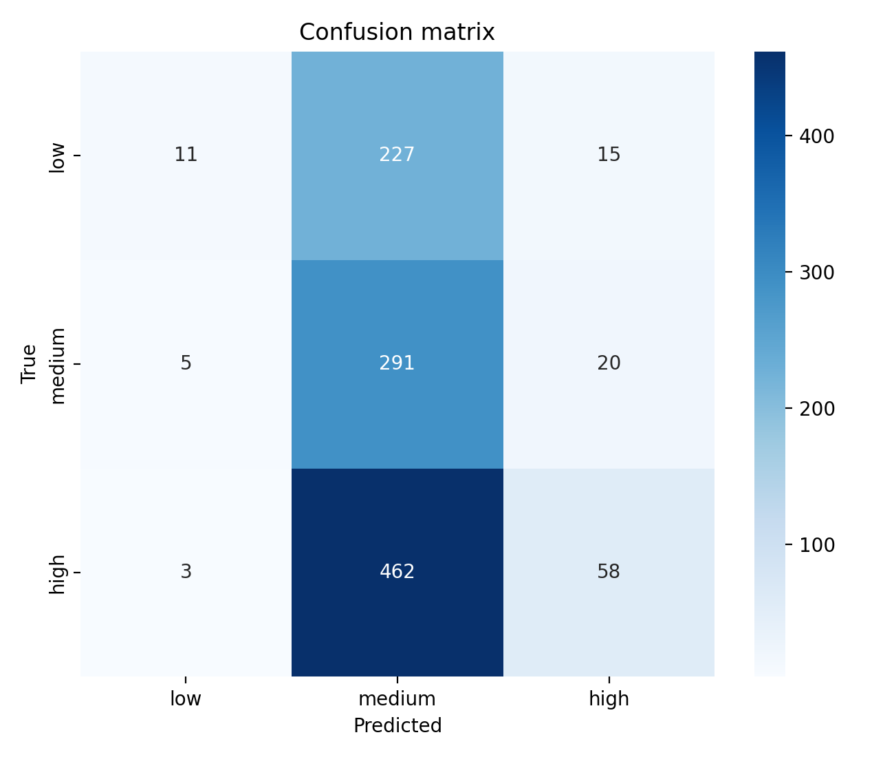
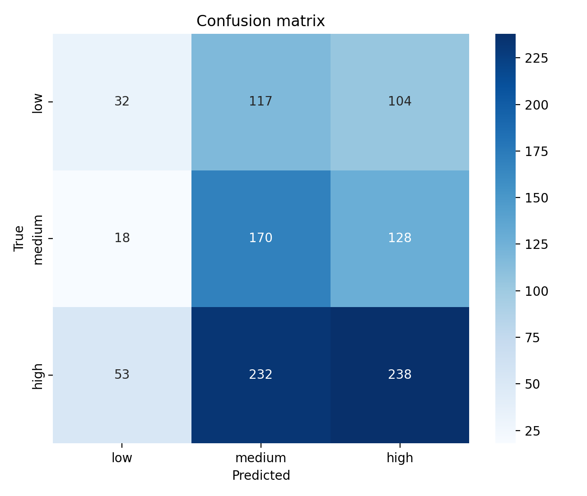

# Experimental Results

This report summarizes the validated seven-model comparison for three-class
self-reported arousal classification on DREAMER. It contains only corrected,
subject-independent measurements. Historical random-window results are excluded.

## Evaluation population

| Partition | Participants | Windows | Low | Medium | High |
|---|---|---:|---:|---:|---:|
| Train | 2, 3, 4, 7–10, 12, 15–23 | 6,188 | 1,441 | 1,778 | 2,969 |
| Validation | 1, 6, 11 | 1,092 | 247 | 322 | 523 |
| Test | 5, 13, 14 | 1,092 | 253 | 316 | 523 |

All samples are non-overlapping 10-second windows. Hyperparameters and deep
checkpoints were selected by validation macro-F1 before the test set was
evaluated.

## Window-level comparison

| Model | Family | Validation macro-F1 | Accuracy | Balanced accuracy | Macro-F1 | Macro-AUROC |
|---|---|---:|---:|---:|---:|---:|
| Adapted stacking | Classical ensemble | 0.3422 | **0.4698** | **0.3930** | **0.3755** | 0.5097 |
| Paper-inspired attention | Deep learning | 0.3070 | 0.4029 | 0.3732 | 0.3554 | **0.5117** |
| kNN | Classical ML | **0.3594** | 0.3901 | 0.3160 | 0.3020 | 0.4578 |
| Random forest | Classical ML | 0.3109 | 0.4560 | 0.3449 | 0.2933 | 0.4367 |
| Logistic regression | Classical ML | 0.3179 | 0.3361 | 0.2884 | 0.2791 | 0.4236 |
| RBF SVM | Classical ML | 0.2887 | 0.4524 | 0.3275 | 0.2533 | 0.3945 |
| Base CNN | Deep learning | 0.3411 | 0.3297 | 0.3584 | 0.2394 | 0.4843 |

The adapted stacking ensemble has the highest macro-F1 and balanced accuracy.
Paper-inspired attention is the strongest deep model and improves macro-F1 by
0.1160 over Base CNN. Its macro-AUROC is highest, but differs from stacking by
only 0.0019; this is not enough to support a strong superiority claim.

## Per-class results

| Model | Class | Precision | Recall | F1 | Support |
|---|---|---:|---:|---:|---:|
| kNN | Low | 0.5897 | 0.0909 | 0.1575 | 253 |
| kNN | Medium | 0.2177 | 0.2184 | 0.2180 | 316 |
| kNN | High | 0.4538 | 0.6386 | 0.5306 | 523 |
| Random forest | Low | 0.2500 | 0.0119 | 0.0226 | 253 |
| Random forest | Medium | 0.3675 | 0.1930 | 0.2531 | 316 |
| Random forest | High | 0.4748 | 0.8298 | 0.6040 | 523 |
| Logistic regression | Low | 0.3571 | 0.0791 | 0.1294 | 253 |
| Logistic regression | Medium | 0.2037 | 0.3101 | 0.2459 | 316 |
| Logistic regression | High | 0.4486 | 0.4761 | 0.4620 | 523 |
| RBF SVM | Low | 0.4000 | 0.0079 | 0.0155 | 253 |
| RBF SVM | Medium | 0.3214 | 0.0854 | 0.1350 | 316 |
| RBF SVM | High | 0.4636 | 0.8891 | 0.6094 | 523 |
| Adapted stacking | Low | 0.1481 | 0.0632 | 0.0886 | 253 |
| Adapted stacking | Medium | 0.4714 | 0.4177 | 0.4430 | 316 |
| Adapted stacking | High | 0.5185 | 0.6979 | 0.5949 | 523 |
| Base CNN | Low | 0.5789 | 0.0435 | 0.0809 | 253 |
| Base CNN | Medium | 0.2969 | 0.9209 | 0.4491 | 316 |
| Base CNN | High | 0.6237 | 0.1109 | 0.1883 | 523 |
| Paper-inspired attention | Low | 0.3107 | 0.1265 | 0.1798 | 253 |
| Paper-inspired attention | Medium | 0.3276 | 0.5380 | 0.4072 | 316 |
| Paper-inspired attention | High | 0.5064 | 0.4551 | 0.4794 | 523 |

The high class accounts for 47.9% of test windows. Base CNN predicts medium for
980 of 1,092 windows, explaining its high medium-class recall and poor low/high
recall. Attention distributes predictions more evenly, although low-class
recall remains only 0.1265.

## Trial-level results

Window probabilities were averaged within each participant–trial pair. The
test partition contains 54 trials.

| Model | Accuracy | Balanced accuracy | Macro-F1 | Macro-AUROC |
|---|---:|---:|---:|---:|
| Adapted stacking | **0.4630** | **0.4171** | **0.3843** | 0.5067 |
| Paper-inspired attention | 0.3519 | 0.3403 | 0.3401 | **0.5281** |
| Logistic regression | 0.3333 | 0.3065 | 0.2843 | 0.4534 |
| Random forest | 0.4259 | 0.3619 | 0.2774 | 0.4651 |
| kNN | 0.3519 | 0.3083 | 0.2698 | 0.4356 |
| RBF SVM | 0.4074 | 0.3422 | 0.2487 | 0.4075 |
| Base CNN | 0.3148 | 0.3315 | 0.2174 | 0.5261 |

## Held-out-participant variability

| Model | Participant 5 | Participant 13 | Participant 14 |
|---|---:|---:|---:|
| Adapted stacking | 0.4032 | 0.3960 | 0.2065 |
| Paper-inspired attention | 0.3132 | 0.3593 | 0.2263 |
| Base CNN | 0.3253 | 0.2188 | 0.1091 |

The spread across only three participants demonstrates substantial
cross-participant variability. Aggregate results should not be generalized to
a broad population without wider group-aware evaluation.

## Deep-model training behavior

| Base CNN | Paper-inspired attention |
|---|---|
|  |  |

| Property | Base CNN | Paper-inspired attention |
|---|---:|---:|
| Trainable parameters | 215,843 | 1,846,085 |
| Selected epoch | 25 | 12 |
| Epochs executed | 37 | 24 |
| Best validation macro-F1 | 0.3411 | 0.3070 |
| Final training macro-F1 | 0.8591 | 0.9551 |
| Final validation macro-F1 | 0.1394 | 0.2948 |
| Tesla T4 runtime | 113.39 s | 136.58 s |

The final train/validation gaps show pronounced participant-level overfitting.
No test-driven retraining or post-hoc hyperparameter adjustment was performed.

## Confusion matrices

| Base CNN | Paper-inspired attention |
|---|---|
|  |  |

## Verification status

All seven prediction files were replayed against the fixed 1,092-window test
index. Sample order, labels, probability argmax, confusion matrices, scalar
metrics, trial aggregation, per-class values, participant metrics, and unified
comparison rows matched the stored artifacts. The machine-readable result is
[`verification_summary.json`](../results/corrected/dreamer_arousal_3class/verification_summary.json).
