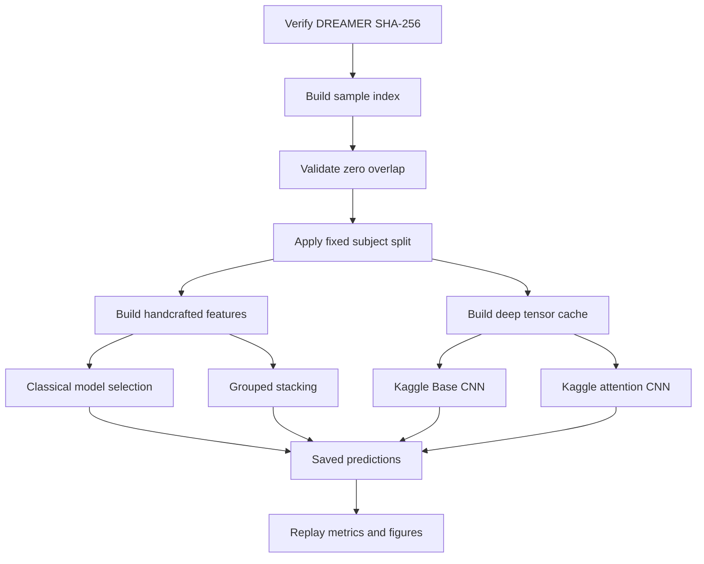

# Methodology and Reproducibility

This report documents the corrected DREAMER protocol, leakage controls, model
architectures, reproducibility workflow, and relationship to the 2026 reference
paper.

## Scientific task

The target is **self-reported arousal**, not stress. DREAMER ratings are mapped
to three classes:

| Class | DREAMER rating | Interpretation |
|---|---:|---|
| Low | 1–2 | Low self-reported arousal |
| Medium | 3 | Midpoint arousal |
| High | 4–5 | High self-reported arousal |

Arousal describes emotional or physiological activation and can be elevated in
stress, fear, excitement, or positive emotion. Stress additionally depends on
a stressor, cognitive appraisal, and context. The two constructs must not be
treated as interchangeable labels.

## Fixed subject split

| Partition | Participant IDs | Participants | Windows |
|---|---|---:|---:|
| Train | 2, 3, 4, 7, 8, 9, 10, 12, 15, 16, 17, 18, 19, 20, 21, 22, 23 | 17 | 6,188 |
| Validation | 1, 6, 11 | 3 | 1,092 |
| Test | 5, 13, 14 | 3 | 1,092 |

Every method uses these partitions and the same ordered sample identifiers.
Validation data determine hyperparameters and checkpoints. Test data are used
only after selection is complete.

## Windowing and leakage controls

Stimulus recordings are segmented into 10-second windows with a 10-second
stride. Every row records participant, trial, window number, and exact EEG/ECG
sample boundaries.

| Leakage risk | Control |
|---|---|
| Overlapping neighboring windows | Window stride equals window duration |
| Same participant in multiple partitions | Fixed participant-level split before fitting |
| Test-dependent normalization | Scalers fit on training data only |
| Feature-selection leakage | ANOVA selection fit inside the applicable training fold |
| Meta-model leakage | GroupKFold out-of-fold predictions for stacking |
| Test-driven model selection | Validation macro-F1 selects settings/checkpoints |
| Reporting inconsistency | Metrics replayed directly from saved probabilities |

EEG is band-pass filtered and normalized per window. ECG is filtered and used
both as a raw waveform and as the source of 25 HRV descriptors. HRV scaling for
deep models is fit on training participants only.

ECG and HRV are expected to be correlated because HRV is mathematically derived
from ECG. The largest absolute training-set Spearman correlation between raw-ECG
and HRV feature blocks is 0.439. Correlation is not evidence of leakage unless
test information enters fitting or selection.

## Handcrafted representation

| Modality block | Features |
|---|---:|
| EEG statistical and band-power descriptors | 238 |
| Raw-ECG statistical and spectral descriptors | 13 |
| ECG-derived HRV descriptors | 25 |
| Total | 276 |

The modality ablation does not show a consistent benefit from adding every
feature block to the selected random-forest configuration:

| Feature block | Macro-F1 |
|---|---:|
| HRV only | 0.310 |
| EEG + ECG + HRV | 0.293 |
| EEG + raw ECG | 0.275 |
| EEG only | 0.249 |
| ECG + HRV | 0.213 |
| Raw ECG only | 0.209 |

## Model architectures

### Base CNN

| Component | Layers |
|---|---|
| EEG branch | Conv1D 14→32 (k7), 32→64 (k5), 64→128 (k3); BN, ReLU, max-pooling, global average pooling |
| ECG branch | Conv1D 1→32 (k15), 32→64 (k9), 64→128 (k5); BN, ReLU, max-pooling, global average pooling |
| HRV branch | Dense 25→64, ReLU, dropout 0.2 |
| Fusion head | Concatenate 320; Dense 256→128→3; dropout 0.4/0.3 |
| Trainable parameters | 215,843 |

### Paper-inspired attention

| Component | Layers |
|---|---|
| EEG | Three Conv1D branches 14→32→64→128 with kernel sets (15,7,3), (31,15,7), and (63,31,15); concatenate 384→512 |
| Raw ECG | Conv1D 1→64→128→256 with kernels 15, 7, and 3 |
| HRV | Dense 25→64→128→256, dropout 0.3 |
| ECG/HRV projection | Concatenate 512→512 |
| Modality attention | Separate 512-dimensional values and 512→128→1 scores; two-way softmax fusion |
| Classification head | Dense 512→256→128→3; BN, ReLU, dropout 0.5 |
| Trainable parameters | 1,846,085 |

## Deep-training protocol

| Setting | Value |
|---|---|
| Framework | PyTorch |
| Optimizer | AdamW |
| Learning rate / weight decay | 3×10⁻⁴ / 10⁻⁴ |
| Scheduler | Cosine annealing to 10⁻⁶ |
| Batch size | 32 |
| Objective | Class-weighted cross-entropy, label smoothing 0.1 |
| Augmentation | Training-only amplitude scaling and Gaussian noise |
| Maximum epochs / patience | 100 / 12 |
| Selection criterion | Validation macro-F1 |
| Seed | 20261011 |
| GPU | Kaggle Tesla T4 |

## Relationship to the 2026 reference paper

The reference is [*An attention-based multimodal deep learning framework
integrating EEG and ECG for enhanced stress detection*](https://doi.org/10.1038/s41598-026-44499-0)
(*Scientific Reports*, 2026). The implemented attention model is a transparent
DREAMER adaptation, not a faithful reproduction.

| Dimension | 2026 paper report | This repository |
|---|---|---|
| Dataset | WESAD + CASE; 35 participants reported | DREAMER; 23 participants |
| Target | Rest, stress, amusement | Low, medium, high self-reported arousal |
| EEG representation | CWT scalograms | Raw temporal 14-channel EEG |
| Backbones | Modified VGG16, EfficientNetB0, ResNeXt50 | Multi-scale Conv1D branches |
| ECG/HRV | Raw ECG path plus 25 HRV features in image system | Raw ECG Conv1D plus 25-feature HRV MLP |
| Attention | Hierarchical attention | Two-way EEG versus ECG/HRV attention |
| Parameters | Approximately 42.7 million | 1.846 million |
| Split | Reported subject-independent 80/10/10 | Fixed participant split 17/3/3 |
| Reported accuracy | 95.7% | 40.29% for the adaptation |

The project adapts non-overlapping segmentation, multi-scale processing, joint
raw-ECG/HRV representation, attention-based fusion, an analogous classifier
head, Adam-family optimization, and cosine scheduling. It does not implement
the paper's CWT images, three image backbones, reported population, or stress
labels.

The official public descriptions of
[WESAD](https://ubi29.informatik.uni-siegen.de/usi/data_wesad.html) and the
[CASE dataset](https://pmc.ncbi.nlm.nih.gov/articles/PMC6785543/) do not
document the EEG configurations attributed to them in the paper, and no
executable mapping was available to resolve this gap. This does not prove that
private or transformed data did not exist; it means the reported inputs cannot
be reconstructed from the available public evidence alone.

Consequently, the paper's 95.7% and this repository's 40.29% attention accuracy
are not directly comparable. They use different datasets, targets, sensor
descriptions, architectures, parameter scales, and evaluation populations.

## Reproduction workflow



### Local validation

```powershell
$env:PYTEST_DISABLE_PLUGIN_AUTOLOAD = "1"
python -m pytest
python scripts/results/verify_experiment_artifacts.py
```

### Kaggle workflow

Generate self-contained notebooks with:

```powershell
python kaggle/build_kernels.py
```

The Kaggle workflow verifies the raw dataset hash and sample IDs before using
the prepared cache. Each deep run saves resolved configuration, source digest,
architecture, parameter counts, epoch history, best/last checkpoints,
predictions, metrics, figures, environment metadata, and runtime.

## Known limitations

- Only three participants are held out for testing.
- Low-arousal recall remains weak for every method.
- Deep models substantially overfit the training participants.
- Ten-second windows limit interpretation of low-frequency HRV measures.
- No confidence interval or broad clinical claim is supported.
- The task is arousal classification, not clinical stress diagnosis.
- The attention network is paper-inspired, not a faithful 2026 reproduction.
